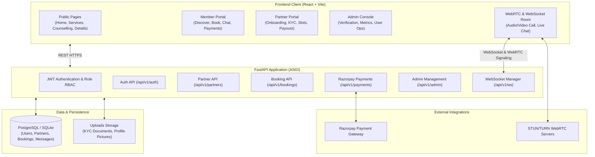
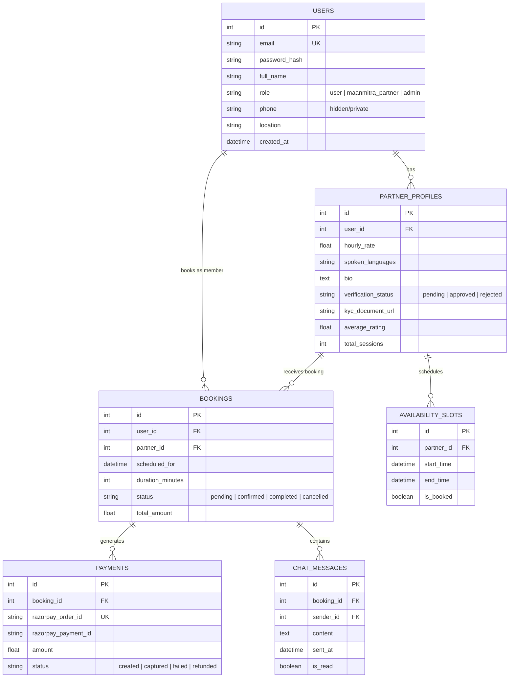

# MAANMITRA (मानमित्र) — Master Project Understanding Document
**"A Listening Friend, Always With You — Connect Hearts, Live Together"**

---

## 1. Executive Summary & Project Vision

### 1.1 Brand Identity & Purpose
**MAANMITRA** is a modern, full-stack, real-time relationship wellness and empathetic companion platform designed to address loneliness, emotional distress, and relationship challenges in contemporary urban society.

Unlike traditional dating apps focused on superficial photo-swiping, MAANMITRA is built around **emotional safety, active listening, deep psychological compatibility, mutual consent, and strict privacy protection**.

- **Brand Name**: MAANMITRA (मानमित्र — "The Mind's Friend / Soul Companion")
- **Tagline**: *"A Listening Friend, Always With You — Connect Hearts, Live Together"*
- **Core Pillars**:
  1. **Empathetic Listening & Companionship**: Safe, judgment-free audio, video, and chat interactions with verified listeners.
  2. **Professional Counselling & Guidance**: Direct access to certified relationship coaches, psychologists, and life mentors.
  3. **Live-in & Relationship Compatibility**: Compatibility scoring and lifestyle alignment for couples and co-habitation seekers.
  4. **Zero-Contact Leak Privacy**: Complete protection of personal phone numbers, addresses, and private identities behind encrypted app boundaries.

---

## 2. Visual Identity & Design System (Color Codes & Tokens)

The visual identity of MAANMITRA is crafted to convey warmth, psychological comfort, trust, and refined luxury. The palette avoids cold clinical blues and loud aggressive tones in favor of **Deep Plum, Romantic Rose, and Soft Blush**.

### 2.1 Complete Brand Color Palette

| Color Name | Hex Code | RGB | CSS Variable | Primary Role & Meaning |
| :--- | :--- | :--- | :--- | :--- |
| **Deep Plum** | `#4A154B` | `rgb(74, 21, 75)` | `--mm-plum` | **Primary Brand Color**: Headers, primary branding, navigation accents, authoritative elements |
| **Plum Dark** | `#320C33` | `rgb(50, 12, 51)` | `--mm-plum-dark` | Deep contrast surfaces, footer backgrounds, dark mode accents |
| **Plum Light** | `#611E63` | `rgb(97, 30, 99)` | `--mm-plum-light` | Hover states for plum buttons and active menu selections |
| **Romantic Rose** | `#E91E63` | `rgb(233, 30, 99)` | `--mm-rose` | **Primary Call to Action (CTA)**: Action buttons, active badges, highlights, love/heart accents |
| **Rose Hover** | `#D81B60` | `rgb(216, 27, 96)` | `--mm-rose-hover` | Button press / hover transitions for interactive buttons |
| **Rose Light** | `#FDE7EF` | `rgb(253, 231, 239)` | `--mm-rose-light` | Soft pill backgrounds, active tab containers, notification glows |
| **Soft Blush** | `#FFF1F5` | `rgb(255, 241, 245)` | `--mm-blush` | **Primary Page Background**: Warm, comforting canvas that reduces eye strain |
| **Blush Dark** | `#FFE4EC` | `rgb(255, 228, 236)` | `--mm-blush-dark` | Subtle card borders, dividers, secondary input backgrounds |
| **Champagne Gold** | `#D4AF77` | `rgb(212, 175, 119)` | `--mm-gold` | **Luxury & Verification**: Verified partner badges, VIP banners, star ratings |
| **Gold Light** | `#FAF3E8` | `rgb(250, 243, 232)` | `--mm-gold-light` | Background container for ratings and verified partner cards |
| **Pure White** | `#FFFFFF` | `rgb(255, 255, 255)` | `--mm-white` | Modal surfaces, content card backgrounds, clean text contrast |
| **Primary Text** | `#32152E` | `rgb(50, 21, 46)` | `--mm-primary-text` | High-contrast body typography, page headings, label text |
| **Secondary Text** | `#756572` | `rgb(117, 101, 114)` | `--mm-secondary-text` | Subtitles, helper text, timestamps, placeholder text |
| **Text Muted** | `#9E8C9B` | `rgb(158, 140, 155)` | `--mm-text-muted` | Inactive icons, breadcrumb dividers, disabled input text |
| **Border Soft** | `#F1DCE5` | `rgb(241, 220, 229)` | `--mm-border` | Default card boundaries, table cell borders, form field outlines |
| **Success Green** | `#22A447` | `rgb(34, 164, 71)` | `--mm-success` | Online status indicator, payment success, approved KYC pill |
| **Success BG** | `#EAF8EE` | `rgb(234, 248, 238)` | `--mm-success-bg` | Background for approved / active status tags |
| **Warning Amber** | `#F59E0B` | `rgb(245, 158, 11)` | `--mm-warning` | Pending verification, slot booking countdown, reminder alerts |
| **Warning BG** | `#FEF7E6` | `rgb(254, 247, 230)` | `--mm-warning-bg` | Background for pending status alerts |
| **Error Red** | `#DC2626` | `rgb(220, 38, 38)` | `--mm-error` | Validation failures, rejected applications, cancelled bookings |
| **Error BG** | `#FEECEE` | `rgb(254, 236, 238)` | `--mm-error-bg` | Error banner backgrounds, form validation error containers |

### 2.2 Shadows & Visual Atmosphere
```css
/* Signature Glow & Elevation Tokens */
--mm-shadow-sm:   0 2px 8px rgba(74, 21, 75, 0.05);
--mm-shadow-md:   0 6px 20px rgba(74, 21, 75, 0.08);
--mm-shadow-lg:   0 16px 36px rgba(74, 21, 75, 0.12);
--mm-shadow-rose: 0 8px 24px rgba(233, 30, 99, 0.28); /* Signature CTA Glow */
```

### 2.3 Typography & Sizing System
- **Font Family**: `'Poppins'`, `'Outfit'`, `'Inter'`, `-apple-system`, `sans-serif`
- **Headings**: `700` / `800` Bold in `#32152E` or Deep Plum `#4A154B`
- **Body Text**: `400` / `500` Regular/Medium in `#32152E`
- **Border Radii**:
  - Small elements (Inputs, Buttons): `8px` (`--mm-radius-sm`)
  - Standard Cards: `14px` (`--mm-radius-md`)
  - Featured Panels: `20px` (`--mm-radius-lg`)
  - Pills / Badges: `9999px` (`--mm-radius-pill`)

---

## 3. High-Level Architecture Overview



---

## 4. Frontend Architecture (React 18 + Vite)

### 4.1 Technology Stack
- **Framework**: React 18 (SPA)
- **Bundler & Dev Server**: Vite 5
- **Routing**: React Router DOM v6
- **State & Session**: React Context API (`AuthContext.jsx`)
- **Icons**: Lucide React
- **Styling**: Modular CSS (`maanmitra_theme.css`, `counselling_services.css`, `styles.css`)
- **API Client**: Native `fetch` with centralized dynamic configuration (`apiConfig.js`)

### 4.2 Centralized Environment Configuration (`src/apiConfig.js`)
To seamlessly work across local development (`localhost:8000`) and production cloud platforms (Render), all API calls use dynamic base resolution:
```javascript
export const API_BASE = (import.meta.env.VITE_API_URL || 'http://localhost:8000/api/v1');
export const WS_BASE  = (import.meta.env.VITE_WS_URL  || 'ws://localhost:8000/api/v1');
```

### 4.3 Page & Portal Breakdown

#### 1. Public Visitor Journey
- `HomePage.jsx`: Hero presentation, feature highlights, verified companion preview, emotional wellness philosophy, statistics.
- `ServicesPage.jsx`: 3 key service tiers (Active Listening, Relationship Coaching, Pre-Cohabitation Guidance).
- `CounsellingPage.jsx`: Filterable practitioner catalog, specialty tags, experience badges.
- `BecomePartnerPage.jsx`: Value proposition for prospective companions (earn hourly, choose hours, 100% remote).
- `PartnerDetailPage.jsx`: Full partner bio, hourly rates, verified badges, available time slot selector, direct booking CTA.
- `HowItWorksPage.jsx` & `FAQPage.jsx`: Step-by-step user onboarding guide and frequently asked safety questions.
- `StaticPages.jsx`: Terms of Service, Privacy Policy, and Refund Policy compliance pages.

#### 2. Authentication System
- `LoginPage.jsx`: Role-aware login (automatically redirects to `/admin/dashboard`, `/partner/dashboard`, or `/user/dashboard`).
- `RegisterPage.jsx`: Quick member signup with instant JWT token assignment.
- `ForgotPasswordPage.jsx`: Account recovery flow.

#### 3. Partner Onboarding & Portal
- `PartnerRegisterPage.jsx`: Application submission (languages, hourly rate, bio, experience).
- `PartnerVerificationPage.jsx`: Government ID upload (Aadhaar / PAN / Certification).
- `PartnerStatusPage.jsx`: Application status tracking (`pending`, `approved`, `rejected`).
- `PartnerDashboardPage.jsx`: Overview of upcoming sessions, earnings, rating, and quick availability toggle.
- `PartnerBookingsPage.jsx`: Accept / reschedule / complete client sessions.
- `PartnerAvailabilityPage.jsx`: Interactive calendar time-slot creator.
- `PartnerEarningsPage.jsx`: Total revenue, platform commission deduction, bank payout status.

#### 4. Member (User) Portal
- `UserDashboardPage.jsx`: Recent bookings, upcoming scheduled calls, favorite companions.
- `UserBookingsPage.jsx`: Active, completed, and cancelled session history with launch buttons for live calls.
- `UserChatsPage.jsx`: In-app direct messaging interface without exposing phone numbers.
- `UserPaymentsPage.jsx`: Payment receipt downloads, transaction history.
- `UserProfilePage.jsx`: Personal preferences, relationship goals, lifestyle tags.

#### 5. Real-Time Communication Room (`LiveCallPage.jsx`)
- Full WebRTC peer connection for 1-on-1 audio/video.
- Live chat drawer over persistent WebSocket connection.
- Session timer with automatic termination when booking duration ends.

#### 6. Admin Portal
- `AdminDashboardPage.jsx`: Platform-wide stats (total users, active partners, gross booking value, platform revenue).
- `AdminPartnersPage.jsx`: Verification workflow — view uploaded KYC documents, approve or reject companion applications.
- `AdminUsersPage.jsx`: User moderation, account suspension, activity inspection.
- `AdminBookingsPage.jsx`: Platform-wide booking registry with dispute intervention.
- `AdminPaymentsPage.jsx`: Razorpay transaction logs, commission settlements.

---

## 5. Backend Architecture (FastAPI + SQLAlchemy)

### 5.1 Technology Stack
- **Framework**: FastAPI (Asynchronous Python ASGI)
- **Server Engine**: Uvicorn (ASGI worker)
- **Database ORM**: SQLAlchemy 2.0 (with Declarative Mapped models)
- **Data Validation & Schemas**: Pydantic v2
- **Password Security**: Passlib with Bcrypt (Blowfish cipher)
- **Session Tokens**: Python-Jose (JWT HS256 signing)
- **Payment Processing**: Official Razorpay Python SDK
- **Database Engines**:
  - Development: SQLite (`living_relationships.db`)
  - Production: Managed PostgreSQL (auto-migrated via URL rewriter)

### 5.2 Database Entity Schema



### 5.3 Core API Endpoints

| Category | Endpoint | Method | Access | Purpose |
| :--- | :--- | :--- | :--- | :--- |
| **Auth** | `/api/v1/auth/register` | `POST` | Public | Register new member |
| **Auth** | `/api/v1/auth/login` | `POST` | Public | Login with email & password, returns JWT |
| **Auth** | `/api/v1/auth/me` | `GET` | Authenticated | Retrieve current user profile & role |
| **Partners** | `/api/v1/partners` | `GET` | Public | List approved companions with filters |
| **Partners** | `/api/v1/partners/{id}` | `GET` | Public | Detailed partner bio, ratings, and rates |
| **Partners** | `/api/v1/partners/register` | `POST` | Authenticated | Apply for companion role |
| **Partners** | `/api/v1/partners/kyc-upload` | `POST` | Partner | Upload ID documents for review |
| **Slots** | `/api/v1/partners/{id}/slots` | `GET` | Public | Fetch available booking slots |
| **Slots** | `/api/v1/partners/slots` | `POST` | Partner | Create available time slots |
| **Bookings** | `/api/v1/bookings` | `POST` | Member | Reserve a session with a partner |
| **Bookings** | `/api/v1/bookings/my` | `GET` | Authenticated | Retrieve user or partner bookings |
| **Payments** | `/api/v1/payments/order` | `POST` | Member | Create Razorpay payment order |
| **Payments** | `/api/v1/payments/verify` | `POST` | Member | Verify Razorpay payment signature & confirm booking |
| **Admin** | `/api/v1/admin/stats` | `GET` | Admin | System dashboard metrics & revenue |
| **Admin** | `/api/v1/admin/partners` | `GET` | Admin | Review pending companion applications |
| **Admin** | `/api/v1/admin/partners/{id}/verify`| `PUT`| Admin | Approve or reject companion KYC |
| **Realtime** | `/api/v1/ws/call/{booking_id}`| `WS` | Participant | Real-time chat & WebRTC video signaling |

---

## 6. Real-Time Communication & WebRTC Architecture

1. **Signaling Server**: FastAPI WebSocket route acts as the exchange exchange broker for WebRTC Session Description Protocol (`SDP` offers & answers) and `ICE` candidate pairs.
2. **Audio/Video Stream**: Once negotiated via the signaling channel, peer-to-peer audio and video flow directly between the member and partner with end-to-end encryption.
3. **Session Auto-Tear Down**: The server maintains a room timer. At the expiration of the booked slot (e.g., 30 or 60 minutes), the WebSocket broadcasts a `session_ended` payload and closes the room to prevent unauthorized overtime usage.

---

## 7. Security, Privacy & Data Protection

1. **Zero Phone Disclosure**: Phone numbers are stored only for emergency contact or payment compliance and are completely stripped from public serialization schemas.
2. **Role-Based Access Control (RBAC)**: All protected routes validate the bearer token and enforce user scopes (`admin`, `maanmitra_partner`, `user`).
3. **Secure Financial Verification**: Razorpay webhooks and payment confirmations require cryptographic HMAC SHA-256 signature verification before any booking is confirmed.
4. **CORS Isolation**: Configured to accept requests from the designated frontend host with strict header checking.

---

## 8. Deployment & Environment Setup

### 8.1 Local Environment
- **Backend Run Command**:
  ```powershell
  powershell -ExecutionPolicy Bypass -File .\run_backend.ps1
  # Runs on http://localhost:8000 (Swagger docs at /docs)
  ```
- **Frontend Run Command**:
  ```powershell
  powershell -ExecutionPolicy Bypass -File .\run_frontend.ps1
  # Runs on http://localhost:5173
  ```

### 8.2 Production Deployment (Render)
- **Repository**: [`https://github.com/Kadshubham1/maanmita.git`](https://github.com/Kadshubham1/maanmita)
- **Configuration File**: `render.yaml`
- **Backend Service**:
  - Environment: Python **`3.11.9`** (pinned via `.python-version`)
  - Build Command: `pip install -r requirements.txt`
  - Start Command: `uvicorn main:app --host 0.0.0.0 --port $PORT`
- **Frontend Service**:
  - Static Site build: `npm install && npm run build`
  - Publish Directory: `dist`
  - Routing: Single-Page Application rewrite (`/*` $\rightarrow$ `/index.html`)

---

## 9. Summary Table for Quick Reference

| Attribute | Specification |
| :--- | :--- |
| **Project Name** | MAANMITRA (मानमित्र) |
| **Platform Category** | Relationship Wellness & Emotional Companionship |
| **Primary Brand Color** | Deep Plum (`#4A154B`) |
| **Primary Accent Color** | Romantic Rose (`#E91E63`) |
| **Primary Canvas Color** | Soft Blush (`#FFF1F5`) |
| **Frontend Stack** | React 18, Vite, React Router 6, Lucide React, Modular CSS |
| **Backend Stack** | Python 3.11, FastAPI, SQLAlchemy 2.0, Pydantic v2, Uvicorn |
| **Database** | SQLite (Dev) / PostgreSQL (Prod) |
| **Realtime Engine** | WebSockets + WebRTC Peer-to-Peer |
| **Payment Gateway** | Razorpay (Orders, Webhooks, Signature Verification) |
| **Deployment Target** | Render (Web Service + Static Site) |
| **Repository** | `https://github.com/Kadshubham1/maanmita.git` |

