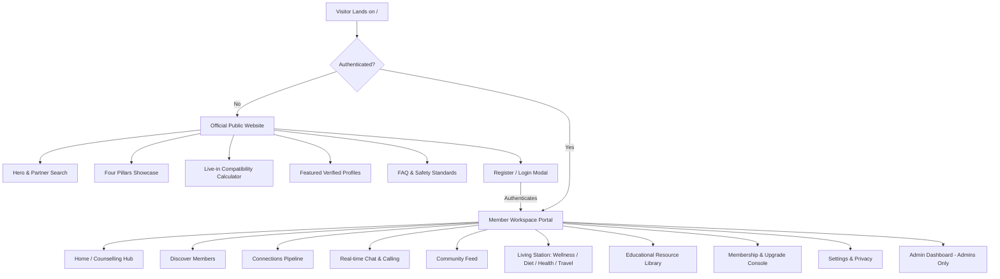
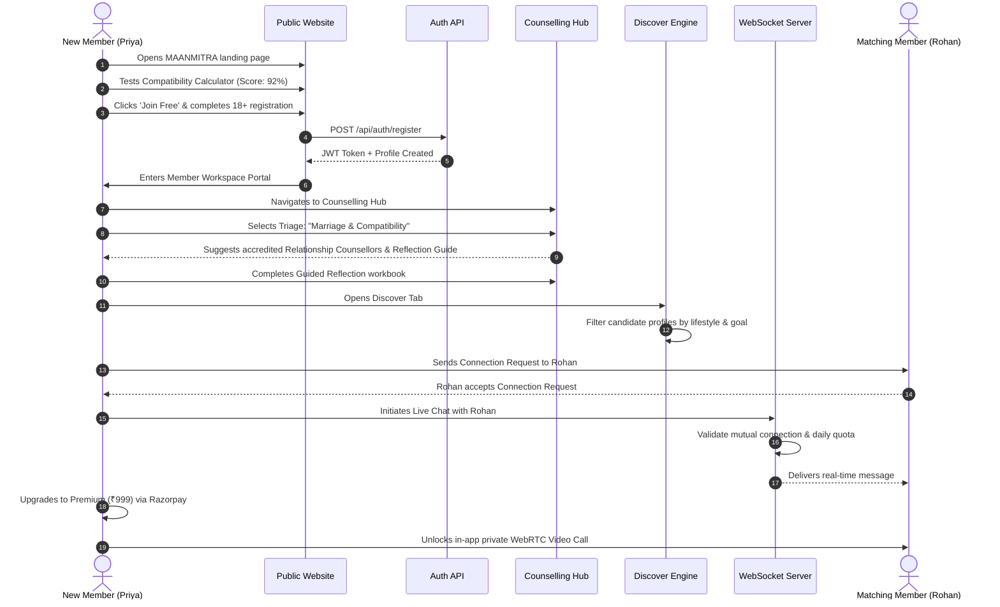
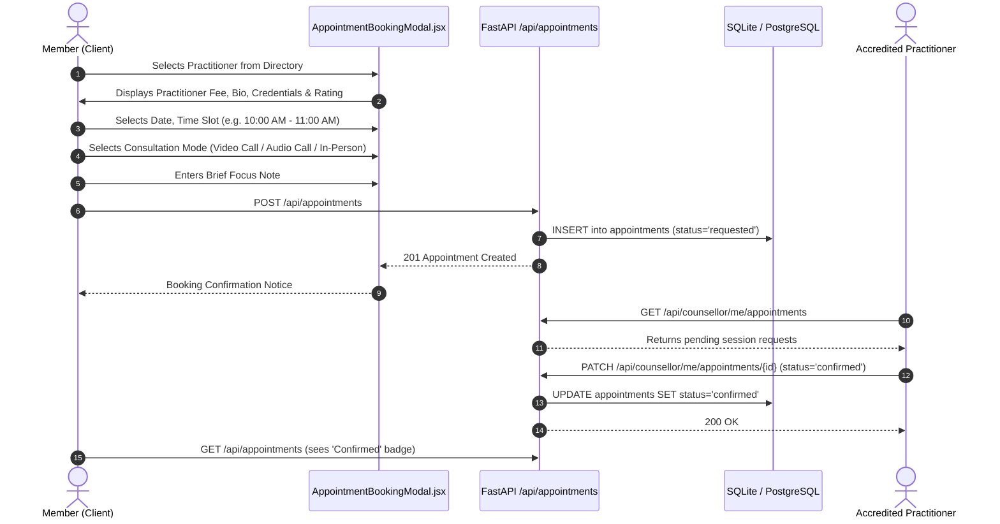
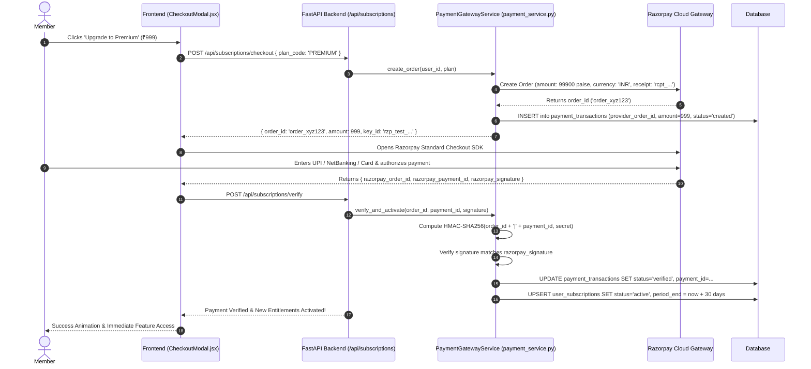
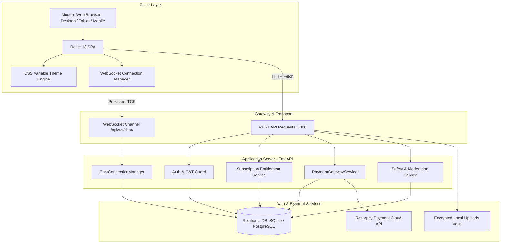

# MAANMITRA — Complete Project Documentation & System Flow Specification
**"A Listening Friend, Always With You — Connect Hearts, Live Together"**

---

## 1. Project Overview and Objectives

### 1.1 Brand Identity & Core Philosophy
**MAANMITRA** (also branded as *MANMITRA*) is a next-generation full-stack digital platform engineered to provide holistic relationship support, compassionate emotional companionship, and consensual co-habitation (live-in relationship) matchmaking. 

Unlike conventional dating applications that rely on superficial photo-swiping, gamified attention mechanics, and fleeting casual encounters, MAANMITRA approaches human intimacy, emotional wellbeing, and shared domestic life through the lens of **deep psychological compatibility, mutual consent, privacy, and clinical wellness guidance**.

* **Primary Brand Name**: `MAANMITRA` (The Mind’s Friend / Soul Companion)
* **Primary Tagline**: `A Listening Friend, Always With You` / `Connect Hearts, Live Together`
* **Operational Vision**: Modern urban life often brings emotional isolation, relationship friction, and uncertainty regarding cohabitation. MAANMITRA bridges this divide by uniting verified partner discovery with accredited relationship counselling, daily couple routines, and structured emotional reflection.

### 1.2 Core Project Objectives
1. **Consensual Live-in Matching**: Enable adult individuals to find compatible domestic partners based on sleep schedules, financial outlooks, lifestyle habits, and core values.
2. **Absolute Privacy & Safety**: Conceal sensitive contact identifiers (such as phone numbers) entirely behind private in-app communication channels and mutual-consent gates.
3. **Integrated Clinical & Emotional Support**: Connect individuals and couples with licensed practitioners, therapists, and certified relationship counsellors across multiple domains (emotional clarity, pre-cohabitation alignment, marital harmony).
4. **Holistic Shared Living Station**: Provide daily tools that encourage healthy cohabitation routines (daily wellness check-ins, joint nutrition planning, encrypted health records storage, and collaborative travel budgeting).
5. **Fair, Transparent Monetization**: Offer transparent, accessible subscription tiers (Free, Basic ₹499/mo, and Premium ₹999/mo) backed by verified Razorpay payments, strictly enforced daily usage quotas, and zero deceptive auto-charges.

---

## 2. Problem Statement and Proposed Solution

### 2.1 Problem Statement
1. **Superficiality of Modern Matchmaking**: Mainstream dating apps incentivize endless browsing based on curated photographs rather than cohabitation compatibility, leading to burnout, mismatched domestic expectations, and emotional disillusionment.
2. **Privacy Vulnerability & Harassment**: Public sharing of personal phone numbers, social media handles, or messaging credentials exposes users (especially women) to unwanted outreach, stalking, and identity abuse.
3. **Stigma Around Seeking Relationship Guidance**: Couples often face high barriers—both cultural and financial—when seeking professional relationship counselling, addressing problems only after relationship breakdown occurs.
4. **Lack of Shared Living Infrastructure**: Existing tools are fragmented; couples use separate apps for messaging, calendar coordination, health records, expense splitting, and dietary tracking.

### 2.2 The MAANMITRA Solution
| Challenge | MAANMITRA Implementation |
| :--- | :--- |
| **Superficial Matches** | Multi-dimensional **Live-in Compatibility Scoring Algorithm** evaluating domestic rhythms, lifestyle style, and personal values. |
| **Privacy Leaks** | **Zero Phone Disclosure Architecture**. Contact numbers are encrypted at rest and omitted from public serializers. Real-time chat and WebRTC calling require mutual consent. |
| **Counselling Stigma & Access** | **Integrated Counselling Hub & Triage System**. Users can explore self-reflection workbooks, read educational guides, or book confidential sessions with verified practitioners. |
| **Fragmented Life Tools** | **Unified Lifestyle Station** combining private daily check-ins, water & fitness tracking, meal planners, medical file vaults, and travel itineraries. |
| **Commercial Exploitation & Bots** | **18+ Age Verification & Credential Review**. Platform administrators manually review practitioner degrees and clinical licenses before approving public listings. |

---

## 3. Business Model and Target Audience

### 3.1 Target Audience
* **Urban Professionals (Age 22–45)**: Educated individuals seeking meaningful, modern, non-traditional companionship, live-in relationships, or marriage alignment.
* **Co-habitating Couples**: Partners already living together who desire a shared hub for emotional grounding, meal planning, and lifestyle coordination.
* **Individuals in Transition**: People navigating relationship crossroads, breakup recovery, or seeking self-clarity before entering commitments.
* **Mental Health & Relationship Practitioners**: Certified psychologists, life coaches, and marriage counsellors seeking an accredited, safe ecosystem to serve clients.

### 3.2 Monetization & Revenue Model
MAANMITRA operates on a hybrid **Freemium + Subscription + Service Fee** model:

```
┌────────────────────────────────────────────────────────────────────────┐
│                        MAANMITRA REVENUE ENGINE                        │
└────────────────────────────────────┬───────────────────────────────────┘
                                     │
         ┌───────────────────────────┼───────────────────────────┐
         ▼                           ▼                           ▼
┌──────────────────┐       ┌──────────────────┐        ┌──────────────────┐
│   Free Tier      │       │  MANMITRA Basic  │        │ MANMITRA Premium │
│     ₹0 / mo      │       │    ₹499 / mo     │        │    ₹999 / mo     │
├──────────────────┤       ├──────────────────┤        ├──────────────────┤
│• Public Website  │       │• 20 Msgs/day     │        │• 200 Msgs/day    │
│• Compatibility   │       │• 5 AI Guides/day │        │• 50 AI Guides/day│
│  Calculator      │       │• Lifestyle Hub   │        │• 1 Free Monthly  │
│• Member Search   │       │• Full Article    │          Counselling      │
│• Profile Setup   │         Library Access   │• In-App Voice &   │
│• Free Articles   │       │• Verified Badge  │  Video WebRTC Call│
└──────────────────┘       └──────────────────┘        └──────────────────┘
```

* **Transaction Commission**: Platform facilitation fee on paid counsellor appointment bookings.
* **Enterprise / Sponsor Partnerships**: Curated wellness and lifestyle brand collaborations.

---

## 4. Complete Feature and Module Description

### 4.1 Official Public Website (`frontend/src/OfficialWebsite.jsx`)
* **Sticky Glass Navigation**: Dynamic header with official vector logo, smooth scroll anchor links, theme toggle, and authenticated portal gateway.
* **Hero Search Widget**: Instant partner search filtering by Gender, Age Range, Location/Region, and Relationship Intent.
* **The Four Foundational Pillars**: Detailed showcases of Verified Profiles, Privacy & Security, Smart Matching, and Live-in Guidance.
* **Interactive Live-in Compatibility Calculator**: Sliders/selectors for Daily Rhythm (Early Riser vs. Night Owl), Living Style (Mindful Minimalist vs. Active Energetic), and Home Atmosphere (Sanctuary vs. Social Hub) producing instant real-time compatibility scores.
* **Verified Member Showcase**: Real-time carousel of verified members displaying compatibility badges and connection triggers.
* **Practitioner Teaser & Triage Preview**: Introduction to professional relationship support categories.
* **Interactive FAQ Accordion**: Clear answers regarding age requirements, phone confidentiality, and safety policies.

### 4.2 Member Workspace Portal (`frontend/src/main.jsx`)
* **Dashboard (Home)**: Personalized greeting, subscription status badge, daily wellness overview, recommended matches, and pending notifications.
* **Discover Engine**: Opposite-gender browsing with debounced search query, lifestyle tags, compatibility percentage badges, and instant connection request dispatch.
* **Connection Center**: Three-stage connection pipeline (`Received`, `Sent`, `Connected`) with Accept, Decline, and Cancel actions.
* **Real-Time Messages (Chat)**: Low-latency one-to-one messaging over WebSockets with live presence indicators and daily quota tracking.
* **Lifestyle & Shared Living Hub**:
  - *Wellness Station*: Daily mood log, water intake counter, movement tracker, and reflection journal.
  - *Diet Planner*: Daily breakfast, lunch, dinner, snack schedules with calorie counters and completion checkboxes.
  - *Medical Vault*: Secure file upload (PDF/PNG/JPG) for confidential medical reports with owner-scoped token download links.
  - *Travel Planner*: Collaborative trip itinerary planner with budget calculation (INR), dates, and shared interests.
* **Community Feed**: Public posts, photo attachments, engagement counts (likes), and member comments.
* **Settings & Privacy Console**: Granular visibility controls (discoverability switch, age toggle, online indicator) and account deletion.

### 4.3 Professional Counselling Ecosystem (`CounsellingHub.jsx`, `CounsellorPortalModal.jsx`)
* **Guided Triage Workflow**: Intuitive 6-path decision tree (*My Relationships*, *Understanding Myself*, *Emotional Support*, *Marriage & Compatibility*, *Personal Growth*, *Something Else*).
* **Practitioner Directory**: Filterable by category, clinical specialization, experience years, and consultation fee.
* **Interactive Booking Engine**: Slot picking, consultation mode selection (Video Call, Audio Call, or In-Person Clinic), and special request notes.
* **Guided Self-Reflection Workbook**: Category-tailored self-reflection questionnaires and psychological grounding exercises.
* **Practitioner Portal**: Dedicated workspace for verified counsellors to review booked sessions, confirm appointments, and manage profile rates.

### 4.4 Administrative Management Suite (`AdminCounsellorVerification.jsx`, `AdminSubscriptions.jsx`)
* **Practitioner Credential Review**: Verification queue for submitted practitioner licenses, qualifications, and degree certificates. Supports status transitions (`Application Submitted` ➔ `Under Review` ➔ `Approved` ➔ `Additional Info Required` ➔ `Not Approved`).
* **Subscription & Revenue Analytics**: Metric cards tracking total revenue (INR), active Basic/Premium members, expired plans, and failed payments.
* **Configurable System Limits**: Live administrative controls to tune daily message caps, daily AI limits, and included counselling sessions without redeploying code.
* **User & Safety Moderation**: Moderation queues to review filed user reports, ban offending accounts, and resolve helpdesk support tickets.

---

## 5. User Roles and Permissions

```
┌─────────────────────────────────────────────────────────────────────────────────┐
│                          ROLE & PERMISSION MATRIX                               │
├──────────────────────┬─────────┬─────────┬─────────┬───────────┬────────────────┤
│ Feature / Action     │ Guest   │ Free    │ Basic   │ Premium   │ Counsellor     │
│                      │ Visitor │ Member  │ Member  │ Member    │ (Practitioner) │
├──────────────────────┼─────────┼─────────┼─────────┼───────────┼────────────────┤
│ Browse Public Web    │   ✅    │   ✅    │   ✅    │    ✅     │       ✅       │
│ Use Compatibility Clc│   ✅    │   ✅    │   ✅    │    ✅     │       ✅       │
│ Discover Profiles    │   ❌    │   ✅    │   ✅    │    ✅     │       ✅       │
│ Send Connection Req  │   ❌    │   ✅    │   ✅    │    ✅     │       ✅       │
│ Send Text Messages   │   ❌    │ 20/day  │ 20/day  │ 200/day   │   Unlimited    │
│ AI Guidance Queries  │   ❌    │  5/day  │  5/day  │  50/day   │   Unlimited    │
│ WebRTC Voice/Video   │   ❌    │   ❌    │   ❌    │    ✅     │   Session Only │
│ Book Counselling     │   ❌    │   ✅    │   ✅    │1 Free/mo  │       N/A      │
│ Access Content Items │ Free Teaser Free  │   All   │    All    │       All      │
│ Manage Appointments  │   ❌    │   ❌    │   ❌    │    ❌     │       ✅       │
│ Admin Verification   │   ❌    │   ❌    │   ❌    │    ❌     │       ❌       │
└──────────────────────┴─────────┴─────────┴─────────┴───────────┴────────────────┘
* Note: Platform Admin role holds superuser authority across all endpoints and data tables.
```

---

## 6. Website Pages and Navigation Flow



---

## 7. Complete User Journey and Application Workflow



---

## 8. Registration and Login Flow

### 8.1 Registration (`POST /api/auth/register`)
1. User provides: `full_name`, `email`, `password`, `gender`, `date_of_birth`, `relationship_goal`.
2. **Server Validation**:
   - Age calculation: verifies `(today - date_of_birth) >= 18 years`. If `< 18`, returns `400 Bad Request: You must be at least 18 years old to join MAANMITRA`.
   - Email format validation and uniqueness check.
3. **Password Security**: Salted and hashed using `passlib.context.CryptContext` with `bcrypt`.
4. **Database Record**: User created with default role `user`, `is_active=True`, `discoverable=True`.
5. **Token Generation**: Generates standard OAuth2 JWT access token containing subject `sub=user_id`, role, and expiry timestamp (7 days default).

### 8.2 Login (`POST /api/auth/login`)
1. Accepts `email` and `password`.
2. Queries database for active user matching email.
3. Verifies password hash using `pwd_context.verify(plain_password, hashed_password)`.
4. Returns bearer token payload: `{"access_token": token, "token_type": "bearer", "user": {...}}`.

---

## 9. Relationship Counselling Services and Pricing Packages

### 9.1 Clinical Counselling Categories
1. **Relationship Harmony**: Communication stumbling blocks, recurring conflicts, trust rebuilding, and emotional attunement.
2. **Understanding Myself**: Personal attachment styles (anxious, avoidant, secure), boundary definition, and emotional self-awareness.
3. **Emotional Support**: Safe space for anxiety management, emotional grounding, and processing past heartbreak.
4. **Marriage & Live-in Readiness**: Financial transparency, cohabitation chores, family expectations, and long-term value alignment.
5. **Personal Growth**: Life transitions, confidence cultivation, and career-relationship balance.

### 9.2 Subscription Pricing Structure
```
┌────────────────────────────────────────────────────────────────────────┐
│                        MEMBERSHIP TIERS IN DETAIL                      │
├─────────────────────┬──────────────────────┬───────────────────────────┤
│ Plan Feature        │ MANMITRA Basic       │ MANMITRA Premium          │
├─────────────────────┼──────────────────────┼───────────────────────────┤
│ Monthly Price (INR) │ ₹499 per month       │ ₹999 per month            │
│ Billing Cycle       │ Monthly recurring    │ Monthly recurring         │
│ Daily Message Limit │ 20 messages / day    │ 200 messages / day        │
│ Daily AI Guidance   │ 5 queries / day      │ 50 queries / day          │
│ In-App Live Calling │ Disabled             │ Enabled (Voice & Video)   │
│ Included Sessions   │ 0 sessions           │ 1 Free Session / Month    │
│ Article Access      │ Full Library         │ Full Library + Exclusive  │
│ Verification Badge  │ Golden Shield        │ Emerald Crown             │
└─────────────────────┴──────────────────────┴───────────────────────────┘
```

---

## 10. Booking and Appointment Workflow



---

## 11. Payment Gateway Integration and Transaction Flow

MAANMITRA implements Razorpay’s official payment order and webhook signature verification standards:



* **Cancellation & Grace Period**: When a user cancels (`POST /api/subscriptions/cancel`), their subscription status updates to `cancelled`, but access remains valid until `current_period_end`.
* **Idempotency Protection**: Order creation uses unique transaction references to prevent duplicate billing.

---

## 12. Admin Dashboard and Management Workflow

The administrative system requires `user.role == 'admin'`:

1. **Practitioner License & Credential Verification (`AdminCounsellorVerification.jsx`)**:
   - Search practitioners by name, email, or medical license number.
   - Filter by status: `Application Submitted`, `Under Review`, `Approved`, `Additional Information Required`, `Not Approved`.
   - Action buttons to approve or request further documents.
2. **Subscription & Revenue Analytics (`AdminSubscriptions.jsx`)**:
   - Total verified revenue calculation in INR.
   - Breakdown of Basic vs. Premium subscriber counts.
   - Historical audit log of every Razorpay transaction with order IDs and payment IDs.
3. **Runtime Limit Configuration**:
   - Dynamic update of message quotas (`BASIC_DAILY_MESSAGE_LIMIT`, `PREMIUM_DAILY_MESSAGE_LIMIT`).
   - Dynamic update of AI reflection quotas (`BASIC_AI_DAILY_LIMIT`, `PREMIUM_AI_DAILY_LIMIT`).
   - Tuning of included monthly counselling sessions.
4. **Member Safety & Report Resolution**:
   - Review incoming member abuse reports with reporter/reported context.
   - One-click account deactivation/suspension.
   - Support ticket triage and resolution.

---

## 13. Technology Stack

### 13.1 Frontend Tier
* **Framework**: React 18.3.1
* **Bundler & Tooling**: Vite 6.1.0 with Fast Refresh
* **Icons**: `lucide-react` 0.468.0
* **Styling**: Vanilla CSS Design System with theme switching (CSS variables for Romantic, Emerald Luxury, and Dark Obsidian modes)
* **Real-time**: Native browser WebSocket API with automatic connection retry and REST fallback

### 13.2 Backend Tier
* **Framework**: FastAPI 0.115+ (Asynchronous Python 3.11+)
* **ASGI Engine**: Uvicorn with high-concurrency event loop
* **ORM & Data Layer**: SQLAlchemy 2.0 with Declarative Mapped Columns
* **Validation**: Pydantic v2 data schemas
* **Authentication**: `python-jose` (JWT), `passlib[bcrypt]`
* **File Handling**: Multipart stream uploading with MIME-type filtering and storage isolation

### 13.3 Database & Storage Tier
* **Relational Database**: SQLite (zero-config local default `living_relationships.db`) / PostgreSQL production-ready
* **File Vault**: Dedicated `/uploads` directory for secure medical records and credential documents
* **Payment Gateway**: Razorpay REST API & Webhook processing

---

## 14. System Architecture Diagram



---

## 15. Database Design and ER Diagram

```
┌─────────────────────────────────┐           ┌─────────────────────────────────┐
│              users              │           │           connections           │
├─────────────────────────────────┤           ├─────────────────────────────────┤
│ id: Integer (PK)                │1         N│ id: Integer (PK)                │
│ email: String (Unique)          ├──────────►│ requester_id: Integer (FK)      │
│ password_hash: String           │           │ receiver_id: Integer (FK)       │
│ full_name: String               │           │ status: String (pending/accept) │
│ username: String (Unique)       │           │ created_at: DateTime            │
│ phone: String (Encrypted)       │           └─────────────────────────────────┘
│ gender: String                  │
│ date_of_birth: Date             │           ┌─────────────────────────────────┐
│ location: String                │           │            messages             │
│ bio: String                     │1         N├─────────────────────────────────┤
│ interests: Text (JSON)          ├──────────►│ id: Integer (PK)                │
│ relationship_goal: String       │           │ sender_id: Integer (FK)         │
│ role: String (user/admin)       │           │ receiver_id: Integer (FK)       │
│ discoverable: Boolean           │           │ body: Text (1-4000 chars)       │
│ is_active: Boolean              │           │ created_at: DateTime            │
│ created_at: DateTime            │           └─────────────────────────────────┘
└────────────────┬────────────────┘
                 │
                 │1
                 │
                 │N
┌────────────────▼────────────────┐           ┌─────────────────────────────────┐
│       user_subscriptions        │           │       daily_usage_tracking      │
├─────────────────────────────────┤           ├─────────────────────────────────┤
│ id: Integer (PK)                │1         N│ id: Integer (PK)                │
│ user_id: Integer (FK)           ├──────────►│ user_id: Integer (FK)           │
│ plan_id: Integer (FK)           │           │ usage_date: Date                │
│ status: String (active/cancel)  │           │ text_messages_count: Integer    │
│ current_period_end: DateTime    │           │ basic_ai_count: Integer         │
│ provider_subscription_id: String│           │ premium_ai_count: Integer       │
└────────────────┬────────────────┘           └─────────────────────────────────┘
                 │
                 │1
                 │
                 │N
┌────────────────▼────────────────┐           ┌─────────────────────────────────┐
│      payment_transactions       │           │          appointments           │
├─────────────────────────────────┤           ├─────────────────────────────────┤
│ id: Integer (PK)                │           │ id: Integer (PK)                │
│ user_id: Integer (FK)           │           │ user_id: Integer (FK)           │
│ subscription_id: Integer (FK)   │           │ counsellor_id: Integer (FK)     │
│ provider_order_id: String       │           │ appointment_date: Date          │
│ provider_payment_id: String     │           │ time_slot: String               │
│ amount: Integer (INR)           │           │ mode: String (video/audio/clinic│
│ status: String (verified/failed)│           │ status: String (requested/conf) │
└─────────────────────────────────┘           └─────────────────────────────────┘
```

---

## 16. API and Backend Workflow

1. **Request Lifecycle**:
   - HTTP request arrives at Uvicorn.
   - Pydantic schema parses and validates JSON request payload.
   - Dependency injection (`get_current_user`) decodes JWT and retrieves active user record.
   - Entitlement checks verify that user’s plan permissions and daily counters allow the action.
   - SQLAlchemy ORM updates database state inside a managed transaction.
   - Serialized response returned with appropriate HTTP status codes (200, 201, 400, 401, 403, 404).

2. **WebSocket Lifecycle**:
   - Handshake initiated at `/api/ws/chat/{user_id}?token={jwt}`.
   - Token decoded; sender and receiver accounts validated.
   - Connection verified: both users must have an `accepted` connection and neither may be blocked.
   - Incoming payload validated for size (1–4000 characters).
   - Message persisted to SQLite/PostgreSQL *before* broadcasting.
   - Real-time event dispatched to both recipient and sender client sockets.

---

## 17. Security and Privacy

1. **Zero Phone Number Disclosure**:
   - User phone numbers are stored strictly for account recovery and two-factor compliance.
   - The public discovery serializer explicitly omits `phone` and `email`.
2. **Mutual Consent Communication Gate**:
   - Users cannot message or call each other unless a mutual connection request has been sent and explicitly accepted.
3. **Medical Vault Isolation**:
   - Health files are saved under randomized UUID storage names in `/uploads`.
   - Files are accessible solely through authenticated token endpoints that verify file ownership.
4. **Payment Cryptographic Integrity**:
   - Razorpay payment activations require HMAC-SHA256 signature verification computed using the server's private secret.

---

## 18. Testing and Deployment

### 18.1 Local Execution
```powershell
# Start Backend (Uvicorn on Port 8000)
powershell -ExecutionPolicy Bypass -File .\run_backend.ps1

# Start Frontend (Vite on Port 5173)
powershell -ExecutionPolicy Bypass -File .\run_frontend.ps1

# Or Single-Click Launch (Windows)
.\start_app.bat
```

### 18.2 Production Container Deployment (`docker-compose.yml`)
```yaml
services:
  backend:
    build: ./backend
    ports: ["8000:8000"]
    volumes: ["./uploads:/app/uploads", "./living_relationships.db:/app/living_relationships.db"]
    environment:
      - DATABASE_URL=sqlite:///./living_relationships.db
  frontend:
    build: ./frontend
    ports: ["80:80"]
    depends_on: [backend]
```

---

## 19. Current Implementation Status and Missing Features

### 19.1 Verified Implemented Features (Operational)
- [x] Complete public landing page with interactive compatibility calculator.
- [x] 18+ age-enforced registration and JWT login authentication.
- [x] Opposite-gender member discovery with compatibility ranking.
- [x] Mutual connection pipeline (Request, Accept, Decline, Cancel).
- [x] Real-time WebSocket chat with daily quota gating and REST fallback.
- [x] Relationship Counselling Hub with triage and category navigation.
- [x] Appointment booking modal and practitioner review portal.
- [x] Admin practitioner credential review dashboard.
- [x] Razorpay order generation, signature verification, and subscription upgrade.
- [x] Admin subscription metrics and live system config updates.
- [x] Lifestyle modules: Wellness check-in, diet planner, travel planner, health reports.
- [x] Granular privacy controls (Discoverable, Age, Online visibility).

### 19.2 Incomplete or Mocked Features (In Progress)
- [ ] **External WebRTC Media Server / TURN Relay**: Calling endpoints generate authenticated session tokens, but audio/video transmission currently relies on browser P2P without dedicated TURN fallback servers.
- [ ] **Live SMS / WhatsApp Notifications**: Appointment reminders currently render in-app rather than via external SMS gateways (e.g. Twilio/Gupshup).
- [ ] **Native Mobile Builds**: The application is fully responsive on mobile browsers, but native Android (APK) and iOS (IPA) wrapper packages are not yet compiled.

---

## 20. Future Enhancements and Conclusion

### 20.1 Future Roadmap
1. **AI Cohabitation Mediator**: Advanced real-time prompt suggestions during couple conversations to de-escalate tension.
2. **Joint Expense Splitter**: Direct UPI-linked cohabitation expense splitting for rent, groceries, and domestic utilities.
3. **Turn-Server Mesh**: High-bandwidth media relay network ensuring 100% connect rates on restricted cellular networks.
4. **Multi-lingual Localization**: Regional Indian language support (Hindi, Marathi, Bengali, Tamil, Telugu).

### 20.2 Conclusion
MAANMITRA redefines digital companionship by placing emotional intelligence, privacy, and clinical relationship wellness at the heart of modern cohabitation. Its solid architectural foundation—pairing React 18, FastAPI, WebSockets, and strict entitlement controls—delivers an inspiring, safe, and sustainable digital haven for individuals seeking to *Connect Hearts and Live Together*.
