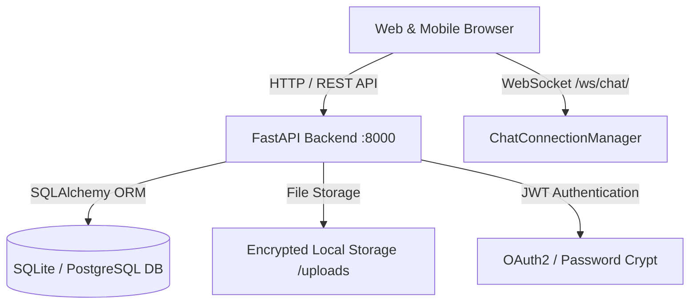

# MANMITRA — Complete Project Documentation
*Connect Hearts, Live Together*

---

## 📋 Table of Contents
1. [Executive Summary & Brand Philosophy](#1-executive-summary--brand-philosophy)
2. [Visual Identity & Design System](#2-visual-identity--design-system)
3. [Full-Stack Architecture & Tech Stack](#3-full-stack-architecture--tech-stack)
4. [Official Public Website Specifications](#4-official-public-website-specifications)
5. [Member Workspace Portal Specifications](#5-member-workspace-portal-specifications)
6. [Real-Time WebSocket Messaging Protocol](#6-real-time-websocket-messaging-protocol)
7. [Database Schema & Entity Relationship](#7-database-schema--entity-relationship)
8. [Complete API Endpoint Reference](#8-complete-api-endpoint-reference)
9. [Privacy, Security & Compliance](#9-privacy-security--compliance)
10. [Local Development, Build & Deployment Guide](#10-local-development-build--deployment-guide)

---

## 1. Executive Summary & Brand Philosophy

**MANMITRA** is a modern, full-stack relationship and live-in matchmaking platform engineered for individuals seeking genuine companionship, emotional alignment, and consensual co-habitation. Unlike conventional dating apps that promote superficial, endless swiping, MANMITRA provides an ecosystem designed around trust, deep compatibility scoring, lifestyle transparency, and mutual respect.

### Brand Mottos & Taglines
* **Primary Brand Name**: `MANMITRA`
* **Primary Tagline**: `Connect Hearts, Live Together`
* **Secondary Slogan**: `REAL PEOPLE • GENUINE CONNECTIONS • A MODERN WAY TO LIVE`

### The Four Foundational Pillars
1. 🤍 **Verified Profiles — Real People, Genuine Intentions**: Strict identity verification and zero tolerance for fake accounts, bots, or unauthorized commercial activities.
2. 🛡️ **Safe & Secure — Your Privacy, Our Priority**: Phone numbers and private identifiers remain 100% confidential and encrypted. 
3. 👥 **Smart Matching — Better Matches, Stronger Bonds**: Matching algorithms that evaluate sleep habits, domestic routines, shared values, and financial expectations.
4. 🌱 **Live-in Support — For a Modern Relationship**: Dedicated relationship tools including wellness check-ins, travel planners, diet routines, and certified counsellor bookings.

---

## 2. Visual Identity & Design System

The platform uses a luxury, high-trust color palette paired with modern geometric typography:

### Color Palette

| Token | Hex Value | RGB / HSL | Usage |
| :--- | :--- | :--- | :--- |
| **Deep Forest Emerald** | `#0F3D37` | `rgb(15, 61, 55)` | Primary brand surfaces, hero banner, primary action buttons, dark brand accents |
| **Champagne Gold** | `#D4AF7C` | `rgb(212, 175, 124)` | Primary accent, vector logo stroke, match percentage badges, interactive highlights |
| **Soft Warm Cream** | `#F7F5ED` | `rgb(247, 245, 237)` | Background canvas, soft card backgrounds, clean contrast |
| **Dark Charcoal** | `#1A1A1A` | `rgb(26, 26, 26)` | High-contrast typography, deep headings, footer background (`#082622`) |

### Typography
* **Primary Heading Font**: `Manrope` & `Outfit` (Weights: 600, 700, 800)
* **Body Font**: `DM Sans` (Weights: 400, 500, 700)
* **Code / Badges**: `Monospace` / letter-spacing `1.5px` to `2.5px`

### Logo & Iconography
* **Symbol**: Two human figures side-by-side with circular heads, an arching body forming the letter **"M"**, and a central **heart** nestled between the figures.
* **Component**: [`frontend/src/ManmitraLogo.jsx`](file:///d:/Downloads/Living_Relationships_Fullstack_Realtime_WebSocket/living_relationships_fullstack/frontend/src/ManmitraLogo.jsx) supporting `horizontal`, `stacked`, `badge` (squircle app icon), and `symbol` variants.

---

## 3. Full-Stack Architecture & Tech Stack



### Technology Matrix
* **Frontend**:
  * **Framework**: React 18.3.1 with Vite 6.1.0 (Module Bundler)
  * **Styling**: Vanilla CSS Design System with CSS variables (`styles.css`), responsive across 320px to 1920px+ viewports
  * **Icons**: `lucide-react` (0.468.0)
* **Backend**:
  * **API Framework**: FastAPI 0.115+ (Python 3.11+)
  * **ASGI Server**: Uvicorn with auto-reload
  * **Data Access**: SQLAlchemy 2.0 ORM with connection pooling
  * **Database**: SQLite (default local) / PostgreSQL compatible
  * **Real-time Protocol**: Native WebSockets with multi-client fanout
  * **Security**: `passlib[bcrypt]` for password hashing, `python-jose` for JWT validation

---

## 4. Official Public Website Specifications

Located in [`frontend/src/OfficialWebsite.jsx`](file:///d:/Downloads/Living_Relationships_Fullstack_Realtime_WebSocket/living_relationships_fullstack/frontend/src/OfficialWebsite.jsx), the public website serves as the primary visitor portal:

1. **Sticky Glass Header**:
   * Official MANMITRA vector logo mark.
   * Smooth navigation anchors: *How It Works*, *Why Manmitra*, *Live-in Match*, *Featured Profiles*, *FAQ*.
   * Call to action buttons: *Sign In*, *Join Manmitra (Free)*, and *Go to Workspace* (for logged-in sessions).
2. **Hero Section & Live Partner Search Filter**:
   * Headline: *"Connect Hearts, Live Together."*
   * Interactive search widget filtering by Gender, Age Range, City/Region, and Relationship Goal.
   * Sunset Couple visual in luxury emerald and gold frame with verified member counters.
3. **Marquee Value Strip**: Continuous ticker highlighting core values: `REAL PEOPLE • GENUINE CONNECTIONS • A MODERN WAY TO LIVE`.
4. **The Four Pillars Showcase**: Detailed breakdowns of Verified Profiles, Safe & Secure, Smart Matching, and Live-in Support.
5. **Interactive Live-in Compatibility Calculator**:
   * Visitors select Daily Rhythm (Early Riser / Night Owl), Living Style (Mindful / Active), and Home Atmosphere (Sanctuary / Social).
   * Generates a real-time **Compatibility Index Score** (e.g. `94%`) with a prompt to view matching verified members.
6. **Featured Verified Members**: Cards highlighting real member profiles, compatibility scores, and one-click connection requests.
7. **How It Works (4 Steps)**:
   * 01: Create Private Profile
   * 02: Complete Identity Verification
   * 03: Mutual Consent Connection
   * 04: Shared Living, Wellness & Guidance
8. **Holistic Relationship Wellbeing**: Presentation of Daily Wellness Station, Shared Travel Planner, and Professional Counselling.
9. **Interactive FAQ Accordion**: Answers concerning verification, phone number privacy, and onboarding fee policies.
10. **Official Footer**: Complete legal, trust, and directory navigation links.

---

## 5. Member Workspace Portal Specifications

Located in [`frontend/src/main.jsx`](file:///d:/Downloads/Living_Relationships_Fullstack_Realtime_WebSocket/living_relationships_fullstack/frontend/src/main.jsx), the member portal is accessible after authentication:

| Module | Purpose & User Capabilities |
| :--- | :--- |
| **Home (Dashboard)** | Welcome banner, live workspace indicator, quick statistics, member match recommendations, and wellness overview. |
| **Discover** | Browse verified members with search query debouncing, filter chips (*For You*, *Nearby*, *New*, *Verified*), and match percentages. |
| **Connections** | Tabbed connection management (*Received*, *Sent*, *Connected*) with Accept, Decline, and Cancel actions. |
| **Messages (Chat)** | One-to-one real-time chat with active connection status indicator (`Live chat`, `Connecting…`, `Offline fallback`). |
| **Community Feed** | Public community posts, image attachments, likes counter, and post author attributions. |
| **Wellness Station** | Private daily check-in (mood tracking, water glasses counter, movement minutes), and engagement score. |
| **Diet Planner** | Meal planning schedule, caloric estimation, and interactive meal completion checkboxes. |
| **Health Reports** | Secure, owner-scoped medical document management (upload, download, delete) supporting PDF, JPG, and PNG formats. |
| **Travel Plans** | Collaborative itinerary planner with destination, INR budget calculation, dates, and interests. |
| **Counselling** | Sample directory of verified counsellors with rating, specialization, fees, and appointment booking requests. |
| **Help & Support** | Support ticketing system categorized by technical, billing, safety, and connection inquiries. |
| **Settings & Privacy**| Granular privacy controls (Discoverable toggle, Show Age toggle, Show Online toggle, and Account Deletion). |
| **Admin Dashboard** | Executive metrics, user activation/deactivation, report moderation, and ticket tracking (Admin-only). |

---

## 6. Real-Time WebSocket Messaging Protocol

Real-time messaging operates strictly between mutually accepted connections.

* **WebSocket URI**: `ws://localhost:8000/api/ws/chat/{peer_user_id}?token={jwt_token}`
* **Connection Lifecycle**:
  1. Client sends authorization token as a query parameter during the WebSocket handshake.
  2. Server verifies JWT signature and validates that the connection between `user_id` and `peer_user_id` is in `accepted` status.
  3. `ChatConnectionManager` adds the socket to an in-memory active connection registry.
  4. Messages sent are persisted into the database first, then broadcast to active recipient sockets.
* **Message Payload Schema**:
  ```json
  {
    "type": "message",
    "body": "Hello! Looking forward to discussing our co-living expectations."
  }
  ```
* **Server Broadcast Payload**:
  ```json
  {
    "type": "message",
    "message": {
      "id": 142,
      "sender_id": 12,
      "receiver_id": 15,
      "body": "Hello! Looking forward to discussing our co-living expectations.",
      "created_at": "2026-10-24T16:00:00.000Z"
    }
  }
  ```
* **Automatic Fallback**: If the WebSocket connection drops, the frontend automatically falls back to authenticated HTTP POST `/api/messages/{user_id}` and polls when active.

---

## 7. Database Schema & Entity Relationship

The system uses SQLAlchemy ORM mapping to SQLite (`living_relationships.db`) or PostgreSQL:

### Core Tables

```
                    ┌──────────────────────────┐
                    │          users           │
                    ├──────────────────────────┤
                    │ id (PK)                  │
                    │ email (Unique)           │
                    │ password_hash            │
                    │ full_name                │
                    │ username (Unique)        │
                    │ gender, location         │
                    │ date_of_birth            │
                    │ bio, interests (JSON)    │
                    │ relationship_goal        │
                    │ role (user / admin)      │
                    │ discoverable, is_active  │
                    └─────────────┬────────────┘
                                  │
         ┌────────────────────────┼────────────────────────┐
         │ 1:N                    │ 1:N                    │ 1:N
┌────────┴────────┐      ┌────────┴────────┐      ┌────────┴────────┐
│   connections   │      │    messages     │      │      posts      │
├─────────────────┤      ├─────────────────┤      ├─────────────────┤
│ id (PK)         │      │ id (PK)         │      │ id (PK)         │
│ requester_id    │      │ sender_id       │      │ author_id       │
│ receiver_id     │      │ receiver_id     │      │ body, image_url │
│ status          │      │ body            │      │ created_at      │
│ created_at      │      │ created_at      │      └─────────────────┘
└─────────────────┘      └─────────────────┘
```

### Auxiliary Modules
* **`wellness_checkins`**: `id`, `user_id`, `mood`, `water_glasses`, `movement_minutes`, `note`, `created_at`.
* **`meals`**: `id`, `user_id`, `name`, `meal_type`, `calories`, `completed`.
* **`health_reports`**: `id`, `user_id`, `original_name`, `storage_path`, `file_size`, `content_type`, `created_at`.
* **`travel_plans`**: `id`, `user_id`, `destination`, `budget`, `start_date`, `end_date`, `interests`, `notes`.
* **`appointments`**: `id`, `user_id`, `counsellor_name`, `appointment_date`, `time_slot`, `mode`, `status`.
* **`support_tickets`**: `id`, `user_id`, `subject`, `category`, `details`, `status`, `created_at`.
* **`safety_reports`**: `id`, `reporter_id`, `target_user_id`, `reason`, `details`, `status`, `created_at`.

---

## 8. Complete API Endpoint Reference

### 🔐 Authentication
* `POST /api/auth/register`: Create account (Requires 18+ validation and terms agreement).
* `POST /api/auth/login`: Authenticate and receive JWT bearer token.

### 👤 Profile & Privacy
* `GET /api/me`: Retrieve current user profile and session data.
* `PATCH /api/me/profile`: Update bio, interests, location, connection goals.
* `PATCH /api/me/privacy`: Toggle discoverability, age visibility, online presence.
* `DELETE /api/me`: Permanently delete account and all associated personal data.

### 🔍 Discovery & Connections
* `GET /api/users/discover?q={query}`: Discover opposite-gender profiles with compatibility scoring.
* `GET /api/connections`: List all incoming, outgoing, and accepted connections.
* `POST /api/connections/{target_id}`: Send a connection request.
* `PATCH /api/connections/{id}?decision={accept|reject|cancel}`: Respond to or cancel requests.

### 💬 Messages & Real-Time Chat
* `GET /api/messages/{peer_id}`: Retrieve chat history with an accepted connection.
* `POST /api/messages/{peer_id}`: Send a text message (REST fallback).
* `WebSocket /api/ws/chat/{peer_id}`: Real-time bi-directional messaging stream.

### 🌟 Lifestyle & Community Modules
* `GET|POST /api/posts`: List or publish community posts.
* `POST /api/posts/{id}/like`: Toggle post like.
* `GET|POST /api/wellness`: Fetch check-in history or submit daily check-in.
* `GET /api/meals`: List meal plan; `PATCH /api/meals/{id}?completed={bool}`: Toggle meal status.
* `GET|POST /api/health-reports`: List or upload private medical documents (multipart).
* `GET /api/health-reports/{id}/download`: Download encrypted health document.
* `DELETE /api/health-reports/{id}`: Delete uploaded health document.
* `GET|POST /api/travel-plans`: Manage shared travel itineraries.
* `GET /api/counsellors`: Directory of certified relationship counsellors.
* `GET|POST /api/appointments`: List or request counsellor appointments.
* `GET|POST /api/support-tickets`: Submit or track helpdesk tickets.

### 🛡️ Administration & Moderation (Admin Only)
* `GET /api/admin/overview`: System-wide counts (users, connections, reports, tickets).
* `GET /api/admin/users`: List all platform users.
* `PATCH /api/admin/users/{id}/status?is_active={bool}`: Activate or deactivate accounts.
* `GET /api/admin/reports`: List safety and abuse reports.
* `PATCH /api/admin/reports/{id}?report_status={status}`: Moderate report status.

---

## 9. Privacy, Security & Compliance

* **Phone Number Concealment**: Contact numbers are strictly encrypted in the database and omitted from all public serializers.
* **Controlled Messaging Access**: Users cannot message each other until a connection request has been mutually accepted.
* **Granular Visibility**: Members can toggle their discovery status off at any time, browsing quietly without appearing in search results.
* **Document Isolation**: Medical reports are isolated in a restricted folder (`/uploads`) and validated through user ownership authorization tokens.
* **Terms of Service & Safe Conduct**: Explicit guidelines enforce mutual respect, adult consent, and prohibition of commercial exploitation.

---

## 10. Local Development, Build & Deployment Guide

### Prerequisites
* **Node.js**: Version 18.0 or higher
* **Python**: Version 3.11 or higher
* **PowerShell**: Windows PowerShell (or Bash on Linux/macOS)

### Quick Start (Windows)

1. **Start Backend**:
   ```powershell
   # In project root
   powershell -ExecutionPolicy Bypass -File .\run_backend.ps1
   ```
   *Runs Uvicorn at `http://localhost:8000` with Swagger docs at `http://localhost:8000/docs`.*

2. **Start Frontend**:
   ```powershell
   # In project root
   powershell -ExecutionPolicy Bypass -File .\run_frontend.ps1
   ```
   *Runs Vite at `http://localhost:5173`.*

### Production Build
To create an optimized production bundle:
```bash
cd frontend
npm run build
```
*Outputs bundled HTML, CSS, and JS to `frontend/dist/`.*

### Docker Deployment
```bash
docker compose up --build
```
*Orchestrates backend, frontend, and database services in isolated containers.*
